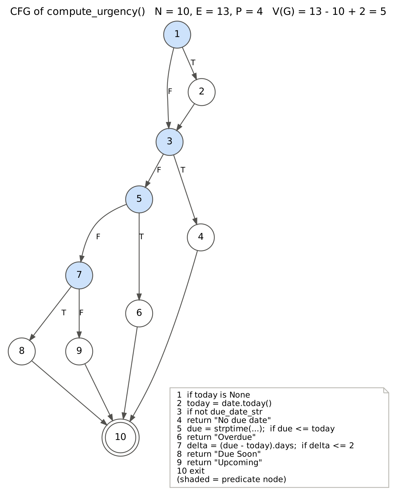
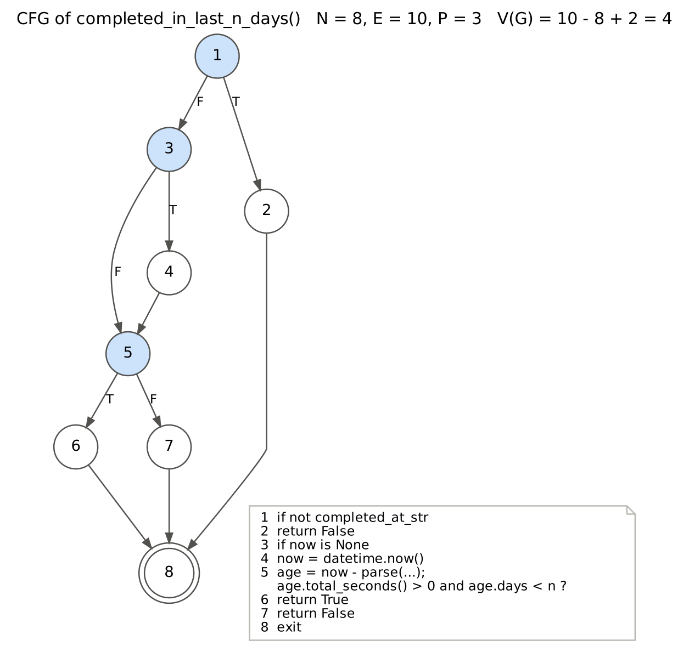

# White-box analysis (Week 2)

## 1. Units selected and why
| Unit | Why | V(G) |
| --- | --- | --- |
| helpers.compute_urgency | Most important business rule; 4 decisions; drives badges and dashboard | 5 |
| helpers.is_valid_password | Registration gate; boundary at 8 | 3 |
| helpers.is_valid_username | Registration gate; range + character rules | 4 |
| helpers.completed_in_last_n_days | Dashboard counter; inclusive boundary; compound condition | 4 |
| app.api_update_task (completed_at) | if / elif / else that sets or clears completion time | 3 |

We did not attempt structural testing of the whole app (brief): helpers.py holds the business rules and is testable
without a server.

## 2. Control-flow analysis

V(G) of compute_urgency, three ways: E − N + 2 = 13 − 10 + 2 = **5**; predicates + 1 = 4 + 1 = **5**; regions = **5**.

## 3. Basis paths (compute_urgency)
| Path | Meaning | Test |
| --- | --- | --- |
| 1-3-4-10 | no due date | TC-WB-001 |
| 1-2-3-5-7-9-10 | today defaulted, far date | TC-WB-002 |
| 1-3-5-6-10 | past date → Overdue | TC-WB-003 |
| 1-3-5-7-8-10 | 1–2 days → Due Soon | TC-WB-005 |
| 1-3-5-7-9-10 | 3+ days → Upcoming | TC-WB-007 |

Plus boundary tests on each decision (TC-WB-004 due today, TC-WB-006 two days). **Path/data-flow notes:** no infeasible
paths; the compound condition `age > 0 and age.days < n` is tested both ways (TC-WB-021/023); `due_date` is defined by
the user, stored without validation and only used in compute_urgency where `strptime` raises (TC-WB-008) — the
root of DEF-008.

## 4. Coverage and interpretation
| Scope | Statements | Stmt % | Branches | Branch % |
| --- | --- | --- | --- | --- |
| helpers.py (unit tests) | 31/31 | 100.0 | 18/18 | 100.0 |
| app.py (all suites) | 294/299 | 98.3 | 57/64 | 89.1 |

- helpers.py is 100% covered yet 3 tests fail: coverage shows what ran, not that it is correct, and it cannot find a
  missing branch (there is no "Due Today" branch at all).
- app.py uncovered lines 242, 266, 375, 481, 482: 242/266 render empty forms on GET (exercised only by
  Selenium, which is not measured); 375 is the API `status=open` filter (**not tested – a gap**); 481–482 is the
  `__main__` start-up block.

## 5. Failed cases
| Test | Objective | Actual | Defect |
| --- | --- | --- | --- |
| TC-WB-004 | Due today returns 'Due Today' (spec) | 'Overdue' | DEF-001 |
| TC-WB-010 | Exactly 8 characters is valid (spec: at least 8) | False | DEF-002 |
| TC-WB-021 | Completed exactly 7 days ago counts (spec: inclusive) | False | DEF-003 |
