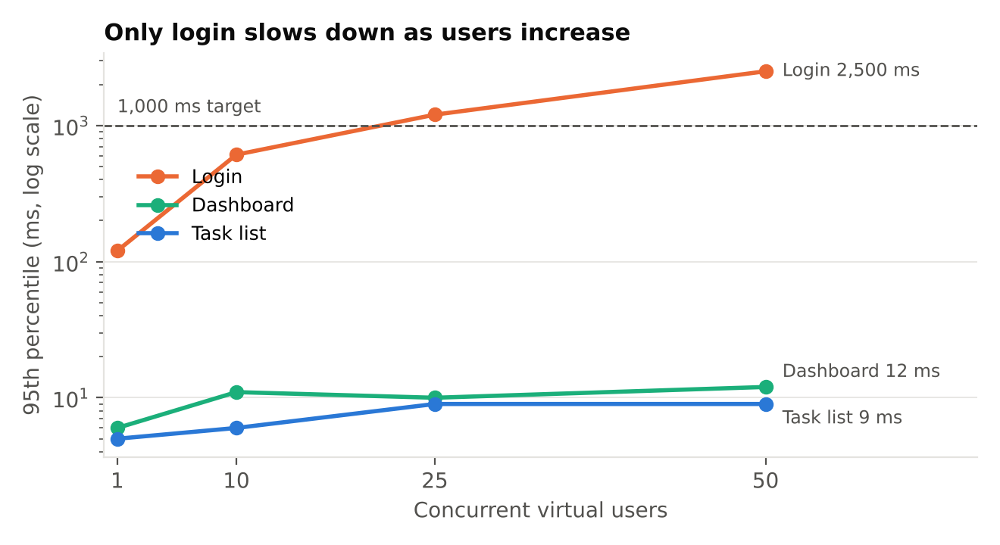

# Performance experiment (Week 5)

## 1. Objective, workload and environment (defined before execution)
- **Objective:** measure response time, throughput and error rate as simulated users increase; find where it degrades.
- **Workload (Locust):** each user logs in once as `perf_user` (100 seeded tasks), then with 1–2 s think time:
  60% GET /api/tasks, 30% GET /api/dashboard, 10% POST /api/tasks.
- **Levels:** 1, 10, 25, 50 users (40 s each, all start together) + stress step of 100 users added 10/s.
- **Criterion:** every request type 95th percentile < 1,000 ms and 0% errors.
- **Environment:** Flask development server (debug on), SQLite, load generator on the same 2-vCPU / 8 GB Linux machine.

## 2. Results
| Users | Task list avg/p95 ms | Dashboard avg/p95 ms | Login avg/p95 ms | Req/s | Errors |
| --- | --- | --- | --- | --- | --- |
| 1 | 4.4/5.0 | 5.0/6.0 | 117.3/120.0 | 0.72 | 0 |
| 10 | 4.2/6.0 | 6.0/11.0 | 567.3/610.0 | 6.87 | 0 |
| 25 | 5.4/9.0 | 6.9/10.0 | 1105.9/1200.0 | 17.06 | 0 |
| 50 | 7.0/9.0 | 10.1/12.0 | 2105.8/2500.0 | 33.15 | 0 |
| 100 (stress) | 5.9/16.0 | 12.2/45.0 | 482.9/560.0 | 61.36 | 0 |

## 3. Interpretation
- Task list and dashboard stay below 15 ms (p95) up to 50 users with 0 errors; throughput grows with users.
- Login is the bottleneck when many users log in in the same second (CPU-heavy password hashing): p95 1,200 ms at
  25 users and 2,500 ms at 50 (DEF-026). With a gradual ramp, 100 users logged in at about 483 ms average.
- The stress step did not reach a breaking point (0 errors).

## 4. Limitations and recommendations
Dev server, shared CPU with the load generator, SQLite, short runs, no CPU/memory monitoring: results show trends,
not production capacity. Recommend a production WSGI server with debug off, login rate limiting, and a repeat test
on a production-like machine with resource monitoring.
